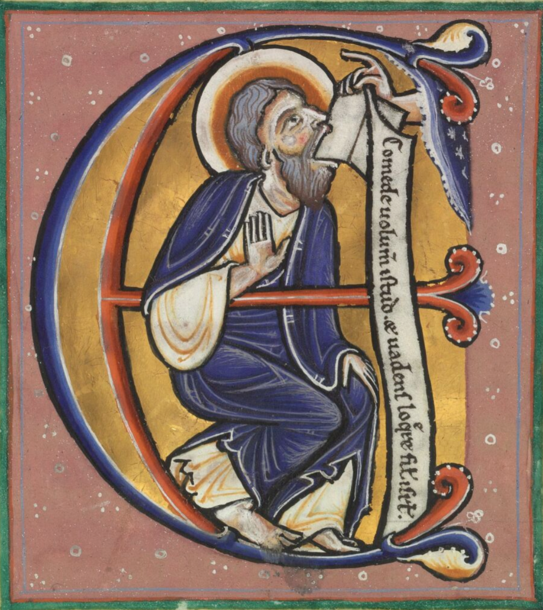

[... work in progress ...]{.section-status .section-status-lead}

```{=html}
<figure id="bookshelf-illustration" class="sidebar-figure">
  
  <figcaption>
    Ézéchiel eating the Book · Latin 16744 <br>
    <a href="https://mandragore.bnf.fr/ark:/12148/cgfbt726103">Bibliothèque nationale de France</a>
  </figcaption>
</figure>
<script>
  document.querySelector(".personal-links").before(
    document.getElementById("bookshelf-illustration")
  );
</script>
```
